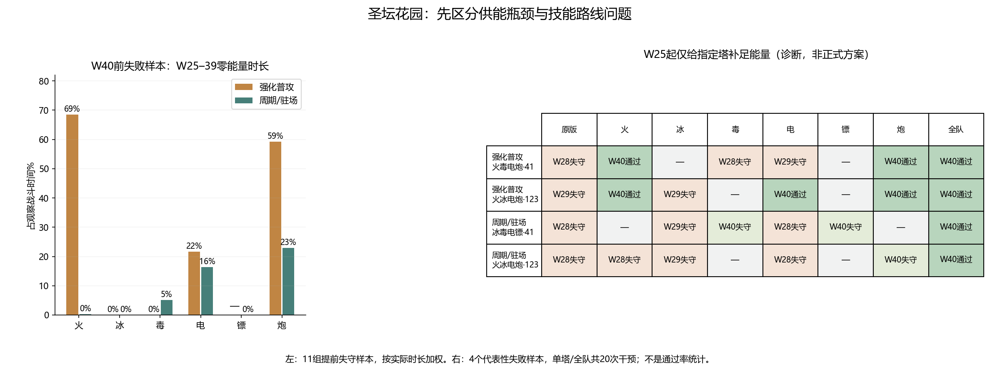

# 圣坛花园W25–39：弱构筑瓶颈诊断

日期：2026-11-10。正式游戏参数未修改；沿用六塔基础攻击和成长直接+20%、花园W40本体108000/分身34560的版本。没有共用增伤。

## 当前基线

24组完整回放：全部通过W20，13组到达W40，8组清理W40；11组在W28–39失守，其中强化普攻路线5组、周期/驻场路线6组。本轮不再重跑后两张地图，不以没有商店/红卡天赋解释这个基准的失败。

## 失败前的实际能量与输出

仅统计11组提前失守样本中W25–39的实际观察时间，按塔实际在场时长加权；不同塔涉及的构筑、等级、技能、圣物和战斗时长不同。不能直接把下表DPS当作同等投入的塔强度排名。低能量列包含0能量，和独立零能量列有交集。

| 路线 | 塔 | 构筑样本数 | 平均能量 | 低于20能量 | 零能量 | 观察DPS |
| --- | --- | ---: | ---: | ---: | ---: | ---: |
| 强化普攻 | 火 | 5 | 1.3 | 100.0% | 68.5% | 772 |
| 强化普攻 | 冰 | 3 | 96.2 | 0.0% | 0.0% | 593 |
| 强化普攻 | 毒 | 3 | 98.7 | 0.0% | 0.0% | 247 |
| 强化普攻 | 电 | 5 | 5.8 | 97.4% | 21.6% | 297 |
| 强化普攻 | 炮 | 4 | 1.8 | 100.0% | 59.3% | 652 |
| 周期/驻场 | 火 | 4 | 32.6 | 25.4% | 0.4% | 777 |
| 周期/驻场 | 冰 | 6 | 34.0 | 12.0% | 0.0% | 287 |
| 周期/驻场 | 毒 | 4 | 21.3 | 39.8% | 5.2% | 848 |
| 周期/驻场 | 电 | 6 | 11.3 | 77.7% | 16.3% | 187 |
| 周期/驻场 | 镖 | 2 | 39.9 | 0.8% | 0.0% | 832 |
| 周期/驻场 | 炮 | 2 | 11.3 | 71.5% | 22.9% | 708 |

强化路线火塔平均能量1.3、零能量68.5%；炮塔平均1.8、零能量59.3%。同一失败样本集合里，冰/毒平均能量约96/99，几乎没有缺能。说明供能压力很不均匀，并非所有塔都缺能。

周期路线电塔观察DPS约187、平均能量11.3；冰塔DPS约287、平均能量34，未出现未足额扣费的周期施法。电/冰路线值得继续核对，但冰墙护盾、减速、麻痹等团队价值不在DPS里，不能只因伤害低就判定应增加基础攻击。

## 单塔供能干预

有意选择4组W40前失守构筑：强化路线火毒电炮·41、火冰电炮·123；周期路线冰毒电镖·41、火冰电炮·123。每组分别干预其4座塔及全队，共20组。均从W1正常回放，W25起在每次战斗更新前将被选塔不足60的能量补至60，超过60的不减少。收费和伤害参数不改。

**这是无限供应的诊断，不是正式补能方案，也不能当作某个真实充能倍率的测试。**补足能量同时恢复伤害档位、射程和周期冷却；之后随机调用、棋盘与选牌可能分叉，因此差值是整场策略净结果，不能全归因于同一技能伤害。

| 原构筑/种子 | 原版 | 只补火 | 只补冰 | 只补毒 | 只补电 | 只补镖 | 只补炮 | 全队 |
| --- | --- | --- | --- | --- | --- | --- | --- | --- |
| 强化普攻·火毒电炮·41 | W28失守 | W40通过 | — | W28失守 | W29失守 | — | W40通过 | W40通过 |
| 强化普攻·火冰电炮·123 | W29失守 | W40通过 | W29失守 | — | W40通过 | — | W40通过 | W40通过 |
| 周期/驻场·冰毒电镖·41 | W28失守 | — | W29失守 | W40失守 | W28失守 | W40失守 | — | W40通过 |
| 周期/驻场·火冰电炮·123 | W28失守 | W28失守 | W29失守 | — | W28失守 | — | W40失守 | W40通过 |

“W40失守”只表示推进到W40，没有通过Boss；“W40通过”要求Boss和残怪全部清理。不存在的塔标—。四个病例不能外推为通关率，也不是完整构筑搜索。

## 结论及下一步优先级

1. **强化普攻路线先处理火/炮能效。**两个选定失败病例，单独补足火或炮均能通过W40；与长期零能量观测一致。优先做多重火球、重炮/双管等具体技能的费用与供能收益对照，暂不再抬六塔攻击。诊断没有证明应采用哪一个实际能耗系数，也不推翻此前保留Boss较高收费的要求。
2. **周期/驻场路线不是“给电塔补能”就能解决。**两例只补电仍在W28失守；只补冰最多延后1波。下一轮应核对电系周期技能的单位施法命中、覆盖和输出预算，以及冰系伤害/控制/护盾的合计贡献；不能仅从本结果认定电塔所有分支都弱。
3. **炮台/毒棒等驻场构筑仍受团队供能约束。**周期路线一例补炮推进至W40，另一例补毒或镖推进至W40，但都未通过；全队补能两例都通过。由此不能把全部失败归为纯伤害不足，也不能用无限能量通过来证明当前真实供能平衡已完成。
4. **保留W40当前参数，优先修W25–39的清怪和积怪。**失败前已出现大量残怪与集中攻城；不把进入W40即快速失守全算到W40Boss身上。W41–60尚待单独复测。

## 校验和复跑

- 两份诊断均与当前攻击配置24组基线逐文件源码哈希一致，正式JS无修改；没有运行中源码变化。
- 四组无干预回放完整复现原结果；两路线各做观察器被动对照；20组干预W25之前逐波结果完全一致，额外能量只给被指定的塔，原始记录保留实际额外能量。
- 仍是正常一星局内圣物获取、无商店、无红卡、无天赋盘、无重掷/复活；未真机测试。
- `node tools/collect-garden-bottlenecks.cjs primary`、`secondary`；`python tools/report-garden-bottlenecks.py`。
