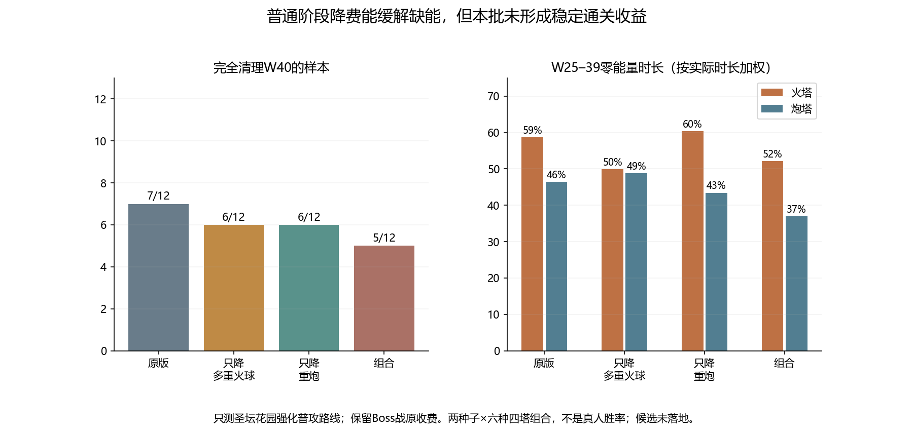

# 圣坛花园：多重火球、重炮、双管齐射能效对照

日期：2026-11-10。正式游戏数值未改，没有采用本轮候选；三项技能正式系数仍各0.8。六塔攻击配置+20%与W40生命预算保留。

## 范围与候选

- 只测圣坛花园强化普攻路线，沿用真实一星圣物获取；无商店、红卡、天赋盘、重掷、复活；没有注入能量。
- 单技能筛选：多重火球、重炮、双管齐射分别从0.8改成0.6，其余保持。组合：多重火球0.6、重炮0.6、双管齐射0.7。仍只在首次激活时应用一次，升级不重复折算。
- 普通怪阶段才使用候选；场上存在活Boss（包括每5波小Boss）或处于锁关战时，保留原0.8。Boss战伤害倍率和计费目标数也不改。记录确认每次Boss出手候选收费与该次原价相等，但战斗节奏、构筑和出手次数变化后，Boss战累计耗能不保证等于基线。
- 先在6个预选病例做三项单技能筛选，共18组。再做完整12组组合回放；多重火球和重炮各补齐另外6组并复用各自筛选6组。共有42组唯一候选回放，文件中54条记录含12条明确复用，不重复计算试验次数。
- 完整路线为两种子×六种四塔组合；筛选里有4个失败病例和2个原通过病例，不是随机抽样。

## 筛选不能代替完整路线验证

| 六病例筛选 | 原通过W40 | 候选通过W40 |
| --- | ---: | ---: |
| 只降多重火球 | 2/6 | 3/6 |
| 只降重炮 | 2/6 | 3/6 |
| 只降双管齐射 | 2/6 | 2/6 |

多重火球和重炮在筛选里各多出1个通过，但扩大到完整路线后没有保住原有通过样本，因此没有仅凭筛选结果上线。双管单项没有新增通过，不继续扩样作为优先候选。

| 完整强化路线 | 到达W40 | 通过W40 | 新通过 | 原通过变失败 |
| --- | ---: | ---: | ---: | ---: |
| 原版 | 7/12 | 7/12 | — | — |
| 只降多重火球 | 8/12 | 6/12 | 1 | 2 |
| 只降重炮 | 8/12 | 6/12 | 1 | 2 |
| 组合方案 | 8/12 | 5/12 | 0 | 2 |

通过指Boss及残怪清理完毕；到达不等于通过。均无时间上限结果计入通过。

## 缺能改善与构筑结果不是一回事

| 方案 | 火塔零能量占比 | 炮塔零能量占比 |
| --- | ---: | ---: |
| 原版 | 58.7% | 46.5% |
| 只降多重火球 | 49.9% | 48.9% |
| 只降重炮 | 60.3% | 43.4% |
| 组合方案 | 52.1% | 37.0% |

上表覆盖完整12组中携带对应塔的W25–39时段，按各自实际时长加权；不是完全相同时长的固定靶对照，也不是只统计原失败的11组。因此原版58.7%/46.5%与上一份“失败样本”报告的68.5%/59.3%口径不同。

本批多重火球和重炮单项各新增火冰电炮·123通过，但火冰毒炮·41及·123均由通过变为失败。组合没有新增通过，同样损失这两例。进入W40时的卡片内容、残怪、城墙和部分塔等级可能变化；相同种子下，扣费改变出手状态、击杀和随机调用，不能把结果简化为“降费让技能变弱”，也不能把补能诊断通过当作小幅降费必然有效。

## 决定与下一步

**不落地本轮降费候选，正式0.8保留。**在当前样本里，有缺能改善但没有稳定的通关改善；两个种子不足以证明降费整体有害，同样不足以支持把未验证收益的组合直接发布。

下一步应先测电系周期技能（球形闪电、雷暴、极光电击）的每次施法命中、有效覆盖和伤害预算，以及对应冰系控制/护盾的贡献；再对火/炮考虑更细的普攻强化计费与供能设计。保留已有的Boss较高收费、一次扣费、缺能继续释放、扣费前伤害快照、不退能/不飞行中重索敌等约定。暂不加六塔攻击，也不进一步削W40。

## 校验

- 所有候选源码快照与当前攻击配置基线一致，逐文件SHA-256确认正式JS未动，运行中无源码变化。未测试后两图及W41–60。
- 六个采集进程均做无候选完整基线复现与观察器被动对照；复用筛选记录逐项一致。不包含被调整技能的冰毒电镖组合完整复现原结果。
- 候选隔离300组用例通过，覆盖未学/激活/升级、Boss/小Boss/锁关/死亡Boss、非普攻收费不受影响、参数不写回；原始JSON保存原价/候选价与各塔费用记录。
- `node tools/test-garden-energy-candidates.cjs`；`node tools/collect-garden-energy-skills.cjs fire60`（另支持heavy60、double60、combined；加full补齐完整路线）；`python tools/report-garden-energy-skills.py`。
