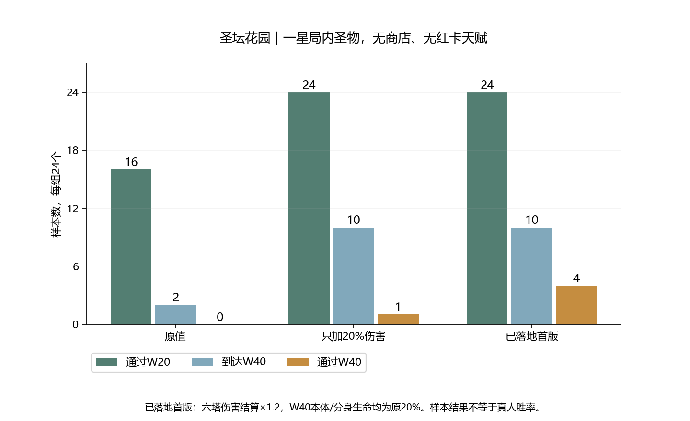

# 圣坛花园入门难度：首版调整与验收

> 历史方案：本文的共用伤害倍率已按用户要求撤销，当前直接提高六塔基础攻击和成长。最新结果见[攻击配置调整](garden-attack-stats-analysis.md)；本文数据保留为当时版本的对照。

日期：2026-11-10。本轮已修改游戏代码，并使用实际参数完成24组完整回放验收。仅测试圣坛花园，未重测熔岩矿场和霜风峡谷。

## 已落地参数

- `js/config/combat-common.js`：`towerDamageMultiplier = 1.2`，六塔来源进入共用伤害结算时增加20%，覆盖该路径的普攻、技能和持续伤害。
- 不提高基础攻击配置或发射伤害快照，避免普攻倍率计费跟着增加；实际费用、各技能0.8折算、经验门槛和经验奖励保持。Boss转阶段溢出进入已结算路径，不重复叠加。
- 固定百分比扣血等原本绕开共用伤害入口的机制保持原口径，不宣称所有扣血路径均增加20%。在途伤害仍为原来的软预估，本轮不叠加索敌调整。
- 花园W40迦尔文本体540000→108000，两个分身各172800→34560；共鸣和幸存回血按各自最大血量计算，也自然同比降低。
- 分裂阈值60%、护甲、本体/分身移速、攻城伤害、共鸣层数、回响减速及小怪配置保持。W20、W60 Boss参数未改。
- 六塔增伤是共用规则，会影响其他战场；后两图的敌人配置、环境规则、出怪数量和Boss接入本轮未改。以后单独用地图强化与敌人设计建立难度递进。

## 为什么同步调整本体与分身

上轮只降低本体生命而保留原分身，不足以降低整场Boss预算。本轮固定六塔伤害增加20%，分别将本体与分身生命一起缩放为原50%、30%、20%；只重放原伤害组自然到达W40的10组，另外14组提前失守，W40参数不可能改变它们此前的结果。

| Boss生命保留比例 | 本体 | 每个分身 | 到达W40的10组中通过 | 折回完整24组通过 |
| --- | ---: | ---: | ---: | ---: |
| 50% | 270000 | 86400 | 1/10 | 1/24 |
| 30% | 162000 | 51840 | 2/10 | 2/24 |
| 20% | 108000 | 34560 | 4/10 | 4/24 |

采用20%档作为首版候选：原本分裂前需打掉216000生命，现为43200；加上两只分身，整场最低净生命损失预算从561600降到112320，未包含护甲、护盾、小怪和回血。保留机制挑战，先移除过高的生命门槛。大幅削减是对原54万预算的校准，不代表已证明全关卡需要同样减血。

## 实际游戏参数验收

随后取消所有离线增伤/Boss注入，使用正式参数从W1完整重放全部24组。每组逐项对照原伤害组或对应Boss候选，结果一致，确认没有再额外乘一次增益。

| 版本 | 通过W20 | 到达W40 | 完整清理W40 | 终止波中位 |
| --- | ---: | ---: | ---: | ---: |
| 原值 | 16/24 | 2/24 | 0/24 | 28.0 |
| 只加20%伤害 | 24/24 | 10/24 | 1/24 | 38.5 |
| 已落地首版 | 24/24 | 10/24 | 4/24 | 38.5 |

这是首版改善，不是“首关已经平衡完成”。仍有14/24组在W40之前失守；能到达W40的10组中4组通过。尤其周期/驻场路线仍有压力，不能只靠进一步削Boss血量解决W29–39的失败。

下一轮应继续只测花园，按失败构筑拆分W25–39的供能、普攻与周期/驻场技能输出，再复测W41–60。W60未在本轮采集，不能宣称已经完成60波通关平衡。

## 验证与范围

- 新增30组条件候选回放、24组正式参数完整回放，另有完整复现及观察器被动检查。没有新跑后两张地图。
- 所有候选W40之前的逐波结果和入场快照与伤害组一致；正式24组与各自候选完整结果一致。
- 一星局内圣物经正常掉落、入盘、开箱和三选一获得，无商店、红卡、天赋盘、局外加成、重掷和复活。两种子、两套固定路线、六种四塔组合，每2秒操作，不是最优构筑搜索或真人胜率。
- 六塔来源、直接/持续伤害、护甲、收费隔离、真实分裂溢出回归通过；原伤害规则、209组周期能量边界、72组组合收费、独立技能系数、25组射程快照、索敌与落点回归通过。实际扣血断言已纳入共用1.2增益，原技能和弹体倍率断言保留。
- 当前JS源码与候选旧快照仅3个文件不同：`js/config/combat-common.js`、`js/combat/damage.js`、`js/config/bosses.js`。本轮未覆盖或还原此前其他修改，未提交Git，尚未真机复测。
- 最新可复跑：`node tools/collect-garden-entry-native.cjs`、`node tools/test-entry-balance.cjs`、`python tools/report-garden-entry.py`。候选采集工具要求旧源码哈希，以防用新参数重算并覆盖历史对照。
