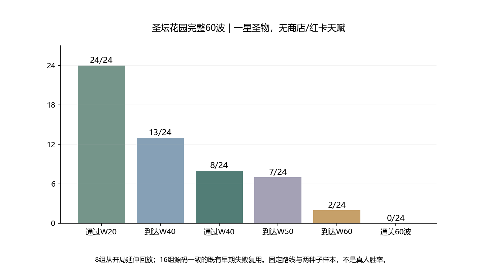

# 收尾第二轮：圣坛花园完整60波复测

> 调整前历史结果。当前已落地花园后半段血量及W60本体/召唤预算调整，最新验收见[后半段单版调整](garden-late-rebalance-analysis.md)。

日期：2026-11-10。本轮正式游戏参数未改；只测圣坛花园。六塔基础攻击/成长+20%、原0.8技能系数、W40本体108000/分身34560保持。

## 口径

- 24组当前基线里，通过W40的8组重新从W1自然推进到清理W60或首次失守；其余16组在W40前或W40已失守，源码一致，因此复用原失败。没有把这些16组冒充新的完整回放。
- 同样两套固定路线、六种四塔组合、两种子、每2秒操作；正常一星圣物获取，无商店、红卡、天赋盘、重掷/复活、注入经验/能量/卡片。W40后奖励正常领取，再继续构筑，不从W40空降满级塔。
- 8组W40之前逐波结果与旧基线完全一致；新增完整回放观察器被动对照通过。3600秒上限不是通关，结果无时间上限样本。

## 24组样本的推进

- 通过W20：24/24；到达W40：13/24；通过W40：8/24。
- 到达W50：7/24；到达W60：2/24；通关60波：0/24。

到达某波不等于清理该波。样本不是完整构筑搜索或真人胜率，也未包含二/三星圣物养成。

| 路线/构筑/种子 | 终止波 | 结果 | 终止塔等级 | 已获取圣物张数 |
| --- | ---: | --- | --- | ---: |
| 强化普攻·火冰毒电·41 | 52 | 失守 | fire:9 / ice:9 / poison:9 / electric:9 | 10 |
| 强化普攻·冰毒电镖·41 | 58 | 失守 | ice:10 / poison:9 / electric:9 / boomerang:9 | 11 |
| 强化普攻·火冰毒炮·41 | 57 | 失守 | fire:10 / ice:9 / poison:9 / cannon:9 | 11 |
| 强化普攻·火冰镖炮·41 | 60 | 失守 | fire:10 / ice:10 / boomerang:10 / cannon:9 | 11 |
| 强化普攻·冰毒电镖·123 | 59 | 失守 | ice:10 / poison:10 / electric:9 / boomerang:9 | 11 |
| 强化普攻·火冰毒炮·123 | 58 | 失守 | fire:10 / ice:9 / poison:9 / cannon:9 | 11 |
| 强化普攻·火冰镖炮·123 | 60 | 失守 | fire:10 / ice:10 / boomerang:10 / cannon:10 | 12 |
| 周期/驻场·火毒电炮·41 | 47 | 失守 | fire:9 / poison:8 / electric:8 / cannon:8 | 9 |

## W60：两组都还在一阶段

| 构筑/种子 | 入场墙血 | 入场等级 | 入场圣物数 | 本波时间 | 失守时阶段 | Boss剩余生命 |
| --- | ---: | --- | ---: | ---: | ---: | ---: |
| 火冰镖炮·41 | 2000 | {'fire': 10, 'ice': 10, 'boomerang': 9, 'cannon': 9} | 11 | 143.6秒 | 1 | 1654493/1800000（91.9%） |
| 火冰镖炮·123 | 2000 | {'fire': 10, 'ice': 10, 'boomerang': 10, 'cannon': 10} | 12 | 168.7秒 | 1 | 1603902/1800000（89.1%） |

代码核对：薇拉本体180万血、初始38%减伤，降至70%生命才进入二阶段，所以一阶段需打掉54万净生命。两组失守前分别只打掉约14.6万和19.6万，尚未触发二/三阶段，因此不能用后续58%护甲、裂坛城墙扣血解释本批一阶段失守。

第一阶段还每10秒召唤3只各11000生命的小怪，单看新增原始血量就是3300/秒，未含护甲、初始随从与前波残怪。两组本波总伤害约65.9万/81.1万包含小怪，不能当作Boss本体单体伤害。

W40整场最低净生命门槛为43200本体阶段损失+2×34560分身=112320；W60本体180万已是其约16倍，尚未计召唤等额外压力。塔在后半段只自然成长到约9–10级，未达到“每塔13级全分支满”。这说明W60预算与当前自然成长需要重新匹配，不能只以满级固定靶DPS判断首关能过。

## 收尾决定

**前两轮检查完成，当前版本仍未达到首关通关平衡。**本轮没有继续叠加全塔攻击，也没有采用先前降费或极光候选。需要集中设计一版W41–60敌群成长及W60本体/召唤预算，再进入最后的修改后回归和真机验收。

不能只削W60本体：8组中已有6组在W47–59失守；即便到达W60，持续召唤也占据很大清怪预算。应把普通敌群成长、Boss生命、随从与召唤作为同一版后半段预算校准，保留Boss机制与已确定的收费规则。

尚未操作真实手机，不能宣称已验收帧率、发热或真人操作体验。先让离线后半段预算达到可评估状态，再由真实设备完成最后一轮验收。

复跑：`node tools/collect-garden-full60.cjs`、`python tools/report-garden-full60.py`。原始数据保留逐波能量/伤害、升级、完整圣物候选与W60每5秒Boss/城墙/构筑快照。
