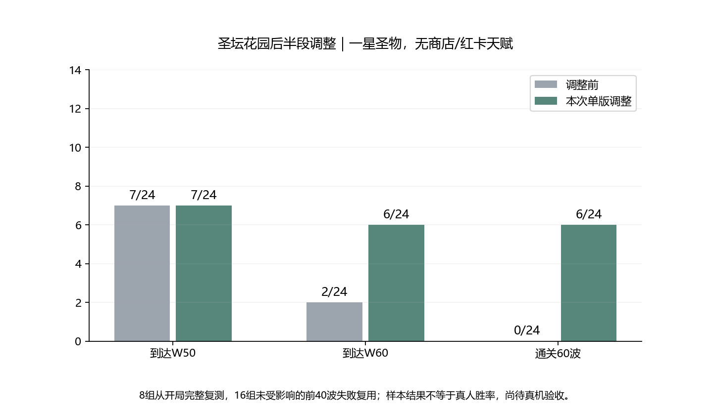

# 圣坛花园后半段：单版调整与离线验收

日期：2026-11-10。已落地本版，只测试圣坛花园；没有继续扩大降费、增伤或极光候选。

## 修改内容

| 项目 | 调整 |
| --- | --- |
| 花园W41–59敌群生命 | 相对原等级表，W41为100%，线性过渡到W59的70%；W50为85% |
| W60薇拉本体 | 1800000→240000 |
| W60每只召唤怪 | 11000→2400；仍每10秒3只 |

花园区间倍率在出生时统一应用一次，涵盖普通怪、精英、小Boss及其出生在区间内的召唤物；不会在后续波次重新缩放存活怪。W1–40、W60及更后波不应用此区间倍率。W60使用独立本体和召唤配置，避免对2400生命再乘70%。

塔基础攻击/成长、技能伤害、攻速、射程、能耗及Boss战较高收费保持；敌人攻击、护甲、移速和数量保持。W60三阶段70%/35%阈值、38%起始/58%上限减伤、每6秒4%城墙裂痕及随从投放机制保持。W60理论召唤新增原始血量从3300/秒降到720/秒。

仅花园配置增加血量曲线；共享怪物等级表未改，熔岩/霜风/深渊/测试战场倍率保持1，没有跑后两图平衡回放。出生、普通波次参考血量和Run波末计算使用同一个倍率；动态小Boss召唤沿用原有追加流程。

## 完整回放结果

对原来通过W40的8组重新从W1自然推进至W60或首次失守；其余16组在W40前或W40失守，变更未覆盖该阶段，因此复用原失败。两套固定路线、六种四塔组合、两种子、每2秒操作；真实一星局内圣物，无商店、红卡、天赋盘、重掷/复活、额外注入资源。

| 24组样本汇总 | 调整前 | 调整后 |
| --- | ---: | ---: |
| 到达W50 | 7/24 | 7/24 |
| 到达W60 | 2/24 | 6/24 |
| 通关60波 | 0/24 | 6/24 |

到达不等于清理该波。通关要求原生终极Boss完成标记、finalVictory和采集终止状态一致；时间上限不是通关。此结果不是玩家胜率，未包含二/三星圣物成长。

| 路线/构筑/种子 | 调整前 | 调整后 |
| --- | --- | --- |
| 强化普攻·火冰毒电·41 | W52失守 | W56失守 |
| 强化普攻·冰毒电镖·41 | W58失守 | 通关60波 |
| 强化普攻·火冰毒炮·41 | W57失守 | 通关60波 |
| 强化普攻·火冰镖炮·41 | W60失守 | 通关60波 |
| 强化普攻·冰毒电镖·123 | W59失守 | 通关60波 |
| 强化普攻·火冰毒炮·123 | W58失守 | 通关60波 |
| 强化普攻·火冰镖炮·123 | W60失守 | 通关60波 |
| 周期/驻场·火毒电炮·41 | W47失守 | W47失守 |

## 回归与边界

- 8组前40波逐波记录均与调整前完全一致；观察器被动对照通过。塔攻击和技能能耗配置没有修改。
- 新增预算回归通过：W40/41/50/59/60/61边界、地图隔离、初始计划/真实出生/普通波次结算倍率一致、动态出生只缩放一次、Vera原生240000生命与每批7200召唤生命、阶段阈值和裂痕80伤害。
- 既有塔伤害、209组周期能量边界、72组组合计费、44组强化发射/52组独立系数、25组射程快照、索敌与落点、W2宝箱与切波能量守恒检查通过。
- 当前源码相对调整前仅5个JS文件改变：config.js、config/bosses.js、新增config/field-balance.js、run.js、wave.js。此前未提交改动均保留，未上传Git。
- 离线检查和本版回归已完成；真机帧率、发热和操作体验尚未验收。本版不以少量固定路线样本宣称首关所有构筑已完全平衡，不继续盲目追加候选，先用真机验证这一版。

## 配置入口与复跑

- 花园区间生命：`js/config.js`的`FIELDS.ancient.lateEnemyHp`；计算函数`js/config/field-balance.js`。
- W60本体/召唤：`js/config/bosses.js`的`altar_vera.hp`与`summonHp`。
- `node tools/test-garden-late-rebalance.cjs`、`node tools/collect-garden-late-rebalance.cjs`、`python tools/report-garden-late-rebalance.py`。
