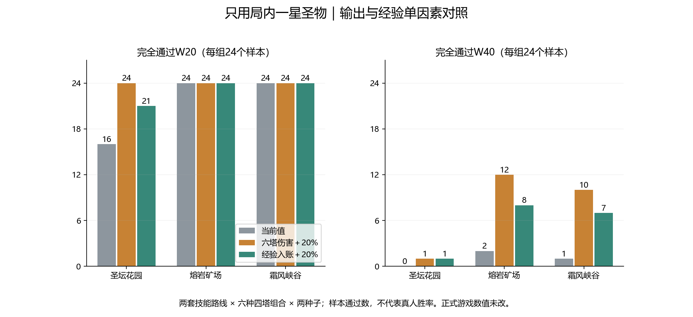

# 圣物单独构筑：输出、经验与花园W40单因素对照

日期：2026-11-10。正式游戏文件及数值未修改；干预仅在独立离线进程的当前战斗实例中生效。

## 范围与干预

- 沿用72组一星圣物基线：三地图、两套技能路线、六种四塔组合、种子41/123，每2秒操作。圣物走真实掉落→入盘→开箱→三选一流程。
- 排除商店、红卡、整个天赋盘、局外圣物加成、二/三星圣物养成、广告复活与重掷。固定路线和选牌启发式不是最优构筑搜索。
- 输出组：六塔普攻、技能及持续伤害进入伤害结算时统一×1.2，再处理护甲；费用、技能倍率、射速不改。这不等同于把基础攻击配置加20%。
- 经验组：所有正经验入账×1.2；经验门槛、初始等级与初始经验不改。后续自然升级及其耗能变化照常发生。
- Boss组：仅对原基线自然到达花园W40的两组，从W1重放；本体血量改为80%或50%，分身血量、护甲、攻城伤害、共鸣和回血全部保留。没有把强行空降W40的样本混入统计。
- 输出/经验各72组，Boss各2组，共148组新增干预回放；旧基线72组复用。每个采集进程另做无干预基线完整复现及观察器被动对照。

## 三地图结果

| 地图 | 调整 | 通过W20 | 到达W40 | 通过W40 | 终止波中位 |
| --- | --- | ---: | ---: | ---: | ---: |
| 圣坛花园 | 当前值 | 16/24 | 2/24 | 0/24 | 28.0 |
| 圣坛花园 | 六塔伤害＋20% | 24/24 | 10/24 | 1/24 | 38.5 |
| 圣坛花园 | 经验入账＋20% | 21/24 | 8/24 | 1/24 | 30.0 |
| 熔岩矿场 | 当前值 | 24/24 | 3/24 | 2/24 | 28.0 |
| 熔岩矿场 | 六塔伤害＋20% | 24/24 | 13/24 | 12/24 | 40.0 |
| 熔岩矿场 | 经验入账＋20% | 24/24 | 11/24 | 8/24 | 33.0 |
| 霜风峡谷 | 当前值 | 24/24 | 6/24 | 1/24 | 28.0 |
| 霜风峡谷 | 六塔伤害＋20% | 24/24 | 13/24 | 10/24 | 40.0 |
| 霜风峡谷 | 经验入账＋20% | 24/24 | 9/24 | 7/24 | 35.5 |

通过W40指Boss及残怪全部清理，只有到达不算通过；时间上限也不算通过。

同种子并不代表干预后棋盘、选牌和升级仍完全相同：更快击杀会改变随机调用顺序和后续决策。这是整场策略回放的净结果，不能全部解释为同一弹体的纯伤害差值。

| 调整 | 终止波更晚 | 相同 | 更早 | 新增通过W40 | 原通过变失败 |
| --- | ---: | ---: | ---: | ---: | ---: |
| 六塔伤害＋20% | 56 | 15 | 1 | 20 | 0 |
| 经验入账＋20% | 48 | 19 | 5 | 15 | 2 |

## 同一批入场样本的成长

仅比较三组都到达该节点的交集；以下均值不拿不同幸存者混比。

| 节点 | 调整 | 交集样本 | 四塔平均等级 | 入场圣物平均张数 |
| --- | --- | ---: | ---: | ---: |
| W20 | 当前值 | 71 | 4.76 | 3.87 |
| W20 | 六塔伤害＋20% | 71 | 4.77 | 3.86 |
| W20 | 经验入账＋20% | 71 | 5.02 | 3.85 |
| W40 | 当前值 | 9 | 7.50 | 8.00 |
| W40 | 六塔伤害＋20% | 9 | 7.50 | 8.00 |
| W40 | 经验入账＋20% | 9 | 7.94 | 8.00 |

## 花园W40：降低本体血量不等于降低整场Boss血量

| 调整/种子 | 结果 | 失守时阶段 | 该阶段剩余血量合计 | 本波时间 |
| --- | --- | ---: | ---: | ---: |
| 当前值·41 | 未通过 | 1 | 431018/540000 | 109.8秒 |
| 当前值·123 | 未通过 | 1 | 428013/540000 | 107.5秒 |
| W40本体血量80%·41 | 未通过 | 1 | 323018/432000 | 109.8秒 |
| W40本体血量80%·123 | 未通过 | 1 | 320013/432000 | 107.5秒 |
| W40本体血量50%·41 | 未通过 | 2 | 339780/345600 | 111.0秒 |
| W40本体血量50%·123 | 未通过 | 2 | 338521/345600 | 107.5秒 |

两组原基线在失守前仅对本体造成约10.9万、11.2万净生命损失，而原本体需要损失21.6万才分裂。改成80%血仍需17.28万，因此仍卡在一阶段；改成50%血只需10.8万，能进入二阶段，但两个分身仍各17.28万，最后几乎满血。两组均未通过。

原配置本体54万、60%分裂；忽略护甲、护盾、小怪及回血，清完本体到分裂和两个分身至少需21.6万＋34.56万＝56.16万净伤害，是W20本体5.2万的10.8倍。这只是生命门槛的算术比较，不能替代实际输出与攻城窗口测算。

本体减半测试不代表把Boss配置总血量减半；实际修改配置中的基础血量还会影响分身，这种联动方案本轮没有测试。不得据此直接认定全局基础攻击应翻倍。

## 结论与下一步建议

本批72组基线通过W40为3组；只增加输出后为23组，只增加经验后为16组。输出组终止波更晚56组、更早1组；经验组更晚48组、更早5组，且有2组原通过样本转为未通过。现有样本更支持优先补有效伤害，而不是先加经验或重新降低能耗。

经验入账增加20%，在三组共同到达节点的样本里，W20入场四塔平均等级约从4.76到5.02，W40从7.50到7.94；没有等比例转化成20%的战斗输出提升。升级也会同时改变费用与技能选择，不能把经验倍率直接当作伤害倍率。

花园W40仍是单独瓶颈：输出组到达10/24、通过1/24，经验组到达8/24、通过1/24。下一轮应把六塔伤害增益作为候选，并另调花园W40的本体、分身及攻城窗口总预算。不能只砍一阶段血量，也不在同一轮同时改经验和能耗。20%是本轮验证过的候选尺度，尚不是已确认的正式发布值。

当前结果仍存在构筑差距：火/冰/电/炮组合在基线、输出组、经验组均无样本通过W40。因此，整体有效输出不足与技能路线间不平衡可能同时存在；本轮不能证明六塔基础攻击都该统一增加20%。后续正式落地前需要拆开普攻、周期技能和驻场伤害，并保护W1–10的原有开局节奏。

## 验证与复跑

- JS源码逐文件SHA-256与圣物原基线一致；四份结果均无运行中源码变化。Boss组W40之前逐波、选牌及入场快照一致，共4组通过。
- 输出组仅记录伤害×1.2，无经验或Boss改动；经验组仅记录经验×1.2；Boss组仅本体出生时改血，二阶段分身实测仍各172800。
- 干预单元用例、圣物策略、移动采集、观察器、切波能量边界检查通过；尚未真机复测。
- `node tools/collect-relic-interventions.cjs damage20`（另支持exp20、boss80、boss50）；`node tools/test-relic-interventions.cjs`；`python tools/report-relic-interventions.py`。
- 原始数据为`docs/relic-intervention-*.json.gz`，含候选/选择、升级、逐波能量、W20/W40快照与Boss血量时间线。
