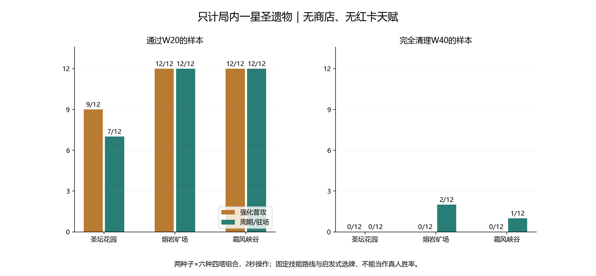

# 仅局内圣遗物：W20/W40通关压力复测

日期：2026-11-10。本轮游戏文件及数值均未修改。

## 口径

- 正常三消与全局技能供能，真实W2/Boss宝箱掉落、入盘、相邻消除、开箱和三选一；不直接注入卡或奖励。
- 新号基线：圣物按实际领取解锁为一星；没有二/三星养成或额外局外加成。这是本轮明确采用的基线，不代表所有圣物星级。
- 排除商店购买/增益、红卡及整个天赋盘、局外旧圣物升级、重掷、广告复活和固定60能量注入。
- 六种四塔组合、两套技能路线、三图、种子41/123，2秒操作。主测试72组；花园强化路线另12组固定选第一张作敏感性对照，总84组。
- 主策略只在已给出的三张里按既定技能相关性、当前能量和前期经验需求选择，不预看未来候选。不是最优构筑搜索。
- 宝箱入盘后优先能相邻消除的合法交换，否则回到普通三连策略；因此不能与无宝箱基线强称相同棋盘操作的纯因果配对。
- 三套采集均通过完整回放的观察器被动对照；检查未获UR、非R不重复、金箱候选全SSR、已选卡一星、商店增益及天赋为零。

## 主测试结果

| 地图/路线 | 通过W20 | 到达W40 | 通过W40 | 终止波中位 |
| --- | ---: | ---: | ---: | ---: |
| 圣坛花园·强化普攻 | 9/12 | 2/12 | 0/12 | 28.0 |
| 圣坛花园·周期/驻场 | 7/12 | 0/12 | 0/12 | 27.5 |
| 熔岩矿场·强化普攻 | 12/12 | 0/12 | 0/12 | 28.0 |
| 熔岩矿场·周期/驻场 | 12/12 | 3/12 | 2/12 | 32.0 |
| 霜风峡谷·强化普攻 | 12/12 | 2/12 | 0/12 | 27.5 |
| 霜风峡谷·周期/驻场 | 12/12 | 4/12 | 1/12 | 30.5 |

通过W40要求Boss及残怪清理完毕；仅到达不算通过。到W40即结束采集，W40通关后金箱不用于证明本次W40输出足够。无时间上限或波次上限结果被冒充通关。

## 圣物有帮助，但尚不足以支撑稳定W40

| 强化路线 | 无圣物通过W20 | 有圣物通过W20 | 无圣物终止波中位 | 有圣物终止波中位 |
| --- | ---: | ---: | ---: | ---: |
| 圣坛花园 | 4/12 | 9/12 | 20.0 | 28.0 |
| 熔岩矿场 | 10/12 | 12/12 | 26.0 | 28.0 |
| 霜风峡谷 | 11/12 | 12/12 | 25.0 | 27.5 |

无圣物参照为同一游戏源码的budget-fix正常供能结果。加入圣物同时恢复真实掉落/领取流程并使棋盘包含宝箱，不把差值全部归因于卡片直接增伤。周期路线不混用旧版本裸测来计算净提升。

花园强化路线固定第一张：通过W20 7/12，终止波中位27.0；按技能相关性选择：通过W20 9/12，终止波中位28.0。这表明选牌策略会影响结果，也不能把本启发式当作玩家最佳表现。

## 花园W40实测：本批卡在一阶段

| 构筑/种子 | 入场圣物张数 | 塔等级 | 本波战斗时间 | 失守时Boss阶段 | 当前阶段剩余血量 |
| --- | ---: | --- | ---: | ---: | ---: |
| wind_artillery·41 | 8 | {"fire": 8, "ice": 8, "boomerang": 8, "cannon": 7} | 109.8秒 | 1 | 431018/540000（79.8%） |
| wind_artillery·123 | 8 | {"fire": 8, "ice": 8, "boomerang": 8, "cannon": 7} | 107.5秒 | 1 | 428013/540000（79.3%） |

两组都已获得8张圣物，塔约7–8级，仍在一阶段失守，Boss约剩80%血，尚未触发双生分裂与回血。因此，不能把这两组的失败归因于二阶段回血；当前首先暴露的是一阶段输出/生存窗口与本体血量、减伤的匹配问题。样本只有两组，不能据此断言所有构筑的Boss瓶颈都相同。

代码核对：花园W40本体54万血、25%减伤，60%血分裂为两个17.28万血/12.5%减伤的分身；双生满共鸣理论回血合计864/秒，周期性对三塔降攻速。二阶段机制仍需后续单独验证，但本轮未用它解释一阶段失守。

## 当前判断和下一步

在新号一星圣物、无商店/无天赋这个基线下，当前构筑的有效输出与成长不足以稳定推进W40。此时不应再把大面积提前失守仅解释为缺少商店和红卡天赋。

需要分开检查：一是多数构筑W20–35的清怪/升级节奏和供能；二是花园W40的本体血量、减伤、攻城窗口与7–8级构筑的匹配。不是已证明六塔基础伤害都应等比例增加。

下一轮适合分别做“只增加输出”“只加快经验成长”“只降低花园W40一阶段压力”的离线干预对照，每次只改一个因素。先定位收益来源，再确定正式调整；不在本轮同时改攻击、经验、Boss血量。

## 边界与复跑

- 星级一星是本轮假设。若目标含二/三星圣物，要另做明确的养成档位对照；没有把三星机制或红卡天赋混入本轮。
- 波次推进不等于已击杀对应Boss或已领到宝箱；未到手奖励没有补发。每局完整候选/选择、星级及W20/W40快照保存在JSON.gz。
- 全队波段伤害包含小怪，不能直接当作Boss单体DPS；未记录的未来潜在伤害不计入。
- `node tools/collect-relic-only.cjs primary build`、`secondary build`、`primary first`；`node tools/test-relic-only-policy.cjs`；`python tools/report-relic-only.py`。
- 三张地图仅两种子、固定路线、简化操作与启发式选牌，结果不是完整构筑穷举或真人胜率；尚未真机验证。本轮只新增/修改tools、docs，没有修改游戏代码或数值。
