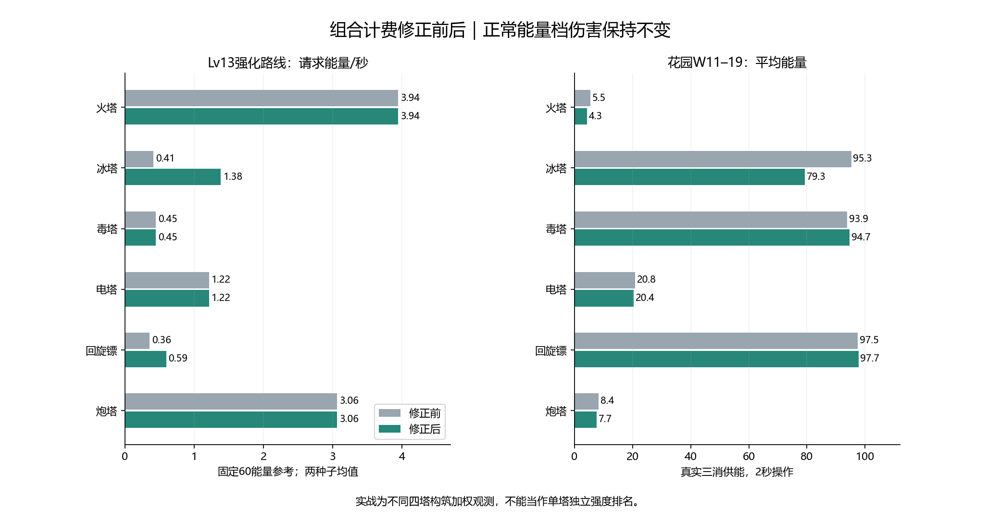

# 冰锥/穿刺、多镖计费修正与复测

日期：2026-11-10。V1.18.9后本地工作区；未发布新版本。

## 已实施

唯一修改的游戏文件为js/combat/attack-energy.js；基础攻击、成长、技能伤害/弹数/碰撞、各技能独立能耗系数均保持。

- 冰锥：多重弹数/伤害倍率与穿透预期倍率相乘。继续使用原60%额外目标占用预估，不根据本次实际敌人数临时重算价格。再乘每个已激活技能自己的系数，各一次；分支升级不多叠折扣。
- 多镖：按实际同轮每枚相同倍率求总和，取消计费独有的逐枚递减。多镖初学时费用略降，高等级原漏算部分补齐；不是所有阶段都涨价。
- 同步核对圣物追加：普通/小冰锥都计入实际追加弹数，穿透计入追加次数；多镖圣物追加数量不会额外增加基础衰减，与发射代码一致。没有新加圣物折扣或重复命中收费。
- 只在出手时扣一次。缺能继续释放并扣光剩余能量，本次伤害仍用扣费前快照；穿透、碎冰、往返扫敌不补扣。Boss沿用预期群体能力收费，不按单目标打折。

## 费用示例

| 构筑 | 修正前费用倍率 | 修正后费用倍率 | 基础普攻费×倍率：前→后 |
| --- | ---: | ---: | ---: |
| 小冰锥C3＋穿刺A3 | 1.152 | 3.9168 | 0.4608→1.56672 |
| 多镖A3 | 1.248 | 2.08 | 0.5408→0.90133 |

这是预期输出计费，不保证每发命中满目标。冰锥示例：18×10%×(1＋60%×4)×0.8×0.8；多镖示例：5×52%×0.8。两个0.8来自两项独立配置，不是全局常数。

## 验证范围

144组固定60能量参考全部与上一轮伤害逐项一致；其他四塔及周期/驻场路线的请求费用也逐项一致。18组实际发射核对确认初始弹数、倍率、穿透上限不变。

新增72组真实弹体计费/碰撞回归，覆盖合法分支组合、缺能与临界能量、圣物追加、独立参数修改、穿透/碎冰/回程不补扣；原44＋52组独立系数、209组周期能量边界、25组射程快照、伤害及六塔选敌/炮弹落点回归通过。

## 三消供能对比

本轮新跑48组受影响的强化路线：三图×两种子×六种四塔组合，花园另测4秒操作；全部使用三消及原全局技能供能，不增加自动回能。对照上一轮相同48组正常供能，不把周期路线旧数据计为本轮新回放，也没有重跑移动中的固定60能量组。

共同棋盘操作前缀共12951步；48/48对在双方共同长度内完全一致。能量变化会影响清怪、经验和敌人状态，因此整局伤害不是单塔纯因果比较。排除圣物/天赋/商店/局外星级；这不是完整玩家养成或真人胜率。

| 塔 | W11–19平均能量：前→后 | 零能时间：前→后 | 请求能量/秒：前→后 | 有效伤害/请求能量：前→后 |
| --- | ---: | ---: | ---: | ---: |
| 火塔 | 5.5→4.3 | 30.7%→38.6% | 0.93→0.99 | 102→104 |
| 冰塔 | 95.3→79.3 | 0.0%→0.0% | 0.35→0.55 | 860→512 |
| 毒塔 | 93.9→94.7 | 0.0%→0.0% | 0.40→0.40 | 236→230 |
| 电塔 | 20.8→20.4 | 3.5%→6.8% | 0.67→0.71 | 187→183 |
| 回旋镖 | 97.5→97.7 | 0.0%→0.0% | 0.31→0.29 | 795→879 |
| 炮塔 | 8.4→7.7 | 15.2%→20.9% | 0.82→0.84 | 110→118 |

上表只含花园、2秒操作、W11–19，按含该塔的构筑在场时间加权。各塔样本数、等级、协同和目标不同；未修改费用的塔也会因共同战场变化而改变观测值。

## 推进和取舍

48组同场景结果：失守波后移1组、不变33组、前移14组。修正规则不是保证胜率上升；第一处补齐计费会降低冰塔维持高能量的能力，随后应据真实能量暴露判断是否需要单独调低相关技能系数。

| 场景 | 修正前失守波中位 | 修正后失守波中位 |
| --- | ---: | ---: |
| 花园2秒 | 20.0 | 20.0 |
| 熔岩2秒 | 26.0 | 26.0 |
| 霜风2秒 | 26.0 | 25.0 |
| 花园4秒 | 11.0 | 11.0 |

只比较首次破防/同一采样上限，走到某波不等于击败该波。高等级完整技能组和后期生存仍需结合局内圣物与玩家选牌验证；没有直接削冰塔伤害或给火/炮补伤害。

## 复跑

- `node tools/test-combined-attack-budget.cjs`。
- `node tools/collect-six-tower-current.cjs fixed budget-fix`；`node tools/collect-six-tower-current.cjs primary budget-fix normal`。
- `node tools/audit-current-attack-budget.cjs budget-fix`；`python tools/report-attack-budget-fix.py`。
- 历史current前缀数据保持原样，新数据使用budget-fix前缀；源码哈希只允许attack-energy.js变化。未真机验证温度、帧率和实际操作体验。
