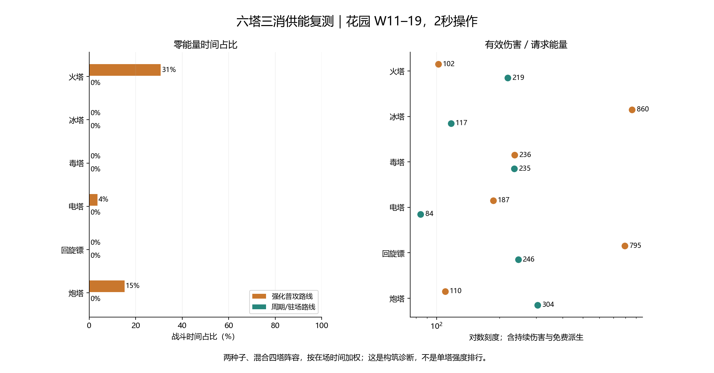

# 六塔当前版：三消供能、能效与成长复测

日期：2026-11-10。V1.18.9后的本地工作区。

## 本轮结论

先处理冰锥/穿刺、多镖的计费预估与实际弹体不一致，再讨论基础攻击和成长调整。火/炮强化路线的供能压力要单独看；不因Boss目标少就下调已确认保留的群体预估收费。

本轮未修改游戏数值：144组固定60能量成长参考＋192组移动供能配对，共336组。另做18组实际发射预算核对。三消供能按真实棋盘和全局技能执行，没有新增0.7能量/秒自动增长。

## 两套路线与方法

| 塔 | 强化普攻路线 | 周期/驻场路线 |
| --- | --- | --- |
| 火塔 | 多重火球·A、大火球·B、灼烧·C | 火柱·A、火雨·B、烈焰墙·B |
| 冰塔 | 多重冰锥·C、冰穿刺·A、碎冰·B | 冰花·B、冬珠·C、冰墙·C |
| 毒塔 | 剧毒·A、瘟疫·A、毒爆·A | 毒棒·B、毒池·B、毒性强化·A |
| 电塔 | 连锁·A、活电·A、麻痹·A | 球形闪电·B、雷暴·A、极光电击·B |
| 回旋镖 | 多镖·A、接镖·A、风痕·B | 弹力镖·B、风暴镖·B、风眼涡旋·C |
| 炮塔 | 重炮·B、双管齐射·A、碎裂弹·C | 炮台·B、炮火支援·A、地雷阵·A |

- 固定靶：Lv4/7/13，两种子，单个大体型Boss或12个普通体型敌人；预热120秒，计量120秒，60Hz，每次战斗更新前重置60能量。靶不动、不死、无护甲，不代表真人DPS。
- 移动：三张图×两种子×六种四塔组合×正常供能/固定60能量对照；花园另测4秒操作。两套技能路线共192组，真实棋盘/出怪/升级/攻城，全局补能和锻造按原采集策略释放，首次破防或2400秒/60波上限即停。
- 排除圣物、局外星级、天赋和商店，隔离基础构筑；不是完整玩家养成和真人胜率。固定路线按计划选择，不能当作玩家最优构筑。
- 60能量对照也会改变射程、清怪、经验、等级和波次时间；它用于诊断供能敏感性，不能把整局总伤比直接解释为纯能耗损失。共同棋盘操作前缀逐步校验，96对通过。

采集工具修复了一处切波统计边界：旧seconds是切波时的数值副本，而towers继续记录本帧，曾相差1/60秒。现在统一在帧后展开计数，分波与整局时间/扣能/零能时长守恒；游戏逻辑未变，历史报告不覆盖。

## 花园W11–19：真实三消供能

两种子、2秒操作，按含该塔的组合在场时间加权。各塔等级、目标、协同不同，不按这一表给单塔排名。请求/实扣包括普通三消额外攻击和周期技能；收益包含免费派生及持续伤害。

| 塔/路线 | 平均等级 | 入账能量/秒 | 请求/秒 | 实扣/秒 | 零能时间 | 伤害/请求能量 | 伤害/实扣能量 |
| --- | ---: | ---: | ---: | ---: | ---: | ---: | ---: |
| 火塔·强化 | 4.5 | 0.73 | 0.93 | 0.71 | 30.7% | 102 | 133 |
| 火塔·周期 | 4.5 | 0.77 | 0.81 | 0.81 | 0.0% | 219 | 219 |
| 冰塔·强化 | 4.3 | 0.39 | 0.35 | 0.35 | 0.0% | 860 | 860 |
| 冰塔·周期 | 4.4 | 0.74 | 0.79 | 0.79 | 0.0% | 117 | 117 |
| 毒塔·强化 | 4.1 | 0.41 | 0.40 | 0.40 | 0.0% | 236 | 236 |
| 毒塔·周期 | 4.2 | 0.75 | 0.81 | 0.81 | 0.0% | 235 | 236 |
| 电塔·强化 | 3.8 | 0.65 | 0.67 | 0.66 | 3.5% | 187 | 190 |
| 电塔·周期 | 3.9 | 0.72 | 0.81 | 0.81 | 0.0% | 84 | 84 |
| 回旋镖·强化 | 3.8 | 0.29 | 0.31 | 0.31 | 0.0% | 795 | 795 |
| 回旋镖·周期 | 3.8 | 0.70 | 0.80 | 0.80 | 0.0% | 246 | 246 |
| 炮塔·强化 | 3.6 | 0.70 | 0.82 | 0.75 | 15.2% | 110 | 120 |
| 炮塔·周期 | 3.7 | 0.71 | 0.78 | 0.78 | 0.0% | 304 | 304 |

“伤害/实扣能量”不能单独作为能效排名：能量不足扣光后仍会释放，甚至0能量也有30%伤害；分母变小可能让这个数看起来更高。须结合请求口径、零能时间、实际伤害、控制和推进判断。入账能量含三消与全局补给，不包含开局存量；能量返还等额外来源依照原技能，不能把此列当完整收支账。

## 已确认的计费预估差异

数据见six-tower-current-attack-budget.json，使用真实attackOnce生成弹体，再读取数量/伤害/穿透上限，不根据文案推算。

1. 按本次普攻基础攻击归一化：小冰锥C3为18枚×10%伤害，普攻费用倍率1.44。再加穿刺A3后，每枚最多命中5个目标，初始弹体合计仍为1.8倍基础攻击，费用倍率却降至1.152；现有multi/else-if分支跳过穿刺贡献，只叠了穿刺自己的0.8。测试构筑等级不同，不能将这里的相同倍率误读成相同绝对攻击。穿透应如何计入组合预估需要统一，不是给每次穿透再次扣能。碎冰的免费派生规则本轮不新增收费。
2. 多镖A3实际5枚各52%伤害，合计2.60倍初始弹体伤害；当前计费前的逐枚递减预估为1.56倍，叠该技能0.8后为1.248倍。若只统一这层初始弹体口径，会是2.60×0.8＝2.08倍；这仅是核对示例，尚未写入游戏。回程和风痕等收益需另按现有规则确认。
这两项会使低耗能路线更容易维持高能量档。先校正预估和实际表现，再评判是否应削攻击，能避免用基础数值掩盖规则差异。

## 同级固定靶成长参考

| 塔/路线 | 单体Lv4→7→13 DPS | Lv13群体DPS | 正常档请求能量/秒 |
| --- | ---: | ---: | ---: |
| 火塔·强化 | 104→336→1276 | 18000 | 3.94 |
| 冰塔·强化 | 297→422→2748 | 2239 | 0.41 |
| 毒塔·强化 | 91→196→604 | 1672 | 0.45 |
| 电塔·强化 | 158→430→1799 | 5217 | 1.22 |
| 回旋镖·强化 | 80→326→2319 | 10033 | 0.36 |
| 炮塔·强化 | 99→223→879 | 16037 | 3.06 |
| 火塔·周期 | 132→320→1198 | 8476 | 0.87 |
| 冰塔·周期 | 117→269→1032 | 6419 | 1.00 |
| 毒塔·周期 | 237→530→1984 | 7457 | 0.95 |
| 电塔·周期 | 95→214→737 | 2736 | 1.23 |
| 回旋镖·周期 | 310→854→3678 | 4586 | 0.76 |
| 炮塔·周期 | 281→691→2700 | 20536 | 1.07 |

Boss靶有较大的碰撞体积，碎冰/多弹可能反复覆盖；12目标组也受位置与穿透路径影响，所以不是简单把单体DPS乘目标数。毒塔传染/毒爆依赖死亡，固定不死靶不能测全。护盾、回血、控制也不能仅按伤害计价；明细CSV保留控制/减速参考。

| 塔 | Lv1基础单发 | 每级单发增长 | Lv13基础单发 | Lv13名义基础DPS |
| --- | ---: | ---: | ---: | ---: |
| 火塔 | 35.0 | 12.5 | 185.0 | 118.4 |
| 冰塔 | 24.0 | 7.3 | 111.3 | 97.9 |
| 毒塔 | 16.0 | 5.0 | 76.0 | 109.4 |
| 电塔 | 30.0 | 9.0 | 138.0 | 110.4 |
| 回旋镖 | 26.0 | 12.9 | 180.3 | 101.0 |
| 炮塔 | 60.0 | 16.7 | 260.0 | 124.8 |

这是不含技能、能量、全局锻造、实际命中和回旋镖往返节奏的配置换算，不是实战DPS。基础成长仍按现有线性规则；当前差异更需要先核对技能乘区、命中覆盖和计费预估，没有据此给六塔基础攻击统一增减。

## 地图、操作节奏和后期样本

| 路线/条件 | 花园2秒：失守波中位 | 熔岩2秒 | 霜风2秒 | 花园4秒 |
| --- | ---: | ---: | ---: | ---: |
| 强化/三消供能 | 20.0（12/12失守） | 26.0（12/12失守） | 26.0（12/12失守） | 11.0（12/12失守） |
| 强化/60能量参考 | 40.0（12/12失守） | 43.5（4/12失守） | 56.5（10/12失守） | 40.0（12/12失守） |
| 周期/三消供能 | 20.0（12/12失守） | 26.0（12/12失守） | 27.5（12/12失守） | 11.0（12/12失守） |
| 周期/60能量参考 | 40.0（12/12失守） | 55.0（12/12失守） | 45.0（12/12失守） | 40.0（12/12失守） |

正常供能样本共96组，其中进入W41及以后只有1组。后期观测具有明显存活筛选，不能用少量幸存构筑给全体晚期强度下结论；Lv13成长由固定同级参考补充。wave_cap、time_cap和“走到W60”均不等于通关，原始终止原因保留。

不同地图Boss与出怪配置不同，不跨图直接评Boss强弱；中位数也不是胜率。变慢操作会同时改变升级、全局技能和清怪，不能用它反推固定自动回能。

## 建议的下一轮顺序

1. 先统一冰锥叠穿刺、多镖的普攻预估口径；保留每技能独立系数、首次激活一次、分支升级不额外叠折扣，以及出手前能量快照。
2. 使用修正口径重新看火/电/炮与冰/毒/镖的真实供能差异；只对必要技能做独立系数试算。Boss仍按已经确认的收费规则，不按单目标临时打折。
3. 费用规则稳定后，再对同级技能成长和基础攻击讨论具体数值；单独保留地雷的窄范围/不移动定位，避免按总伤直接削弱。

## 复跑与验证

- `node tools/collect-six-tower-current.cjs fixed` / `primary` / `secondary`；三个输出各自独立，固定运行时源码快照。
- `node tools/audit-current-attack-budget.cjs`；`python tools/report-six-tower-current.py`。
- 能耗观察器被动性、真实棋盘确定性、同帧切波计数守恒、209组周期能量边界、44+52组独立系数和火冰弹道回归通过。
- 原始回放压缩为JSON.gz，CSV提供逐局、逐波、各塔供能和同级成长；本轮游戏文件哈希与上轮火冰专项完全相同。未进行真机帧率、温度和真人操作验证。
